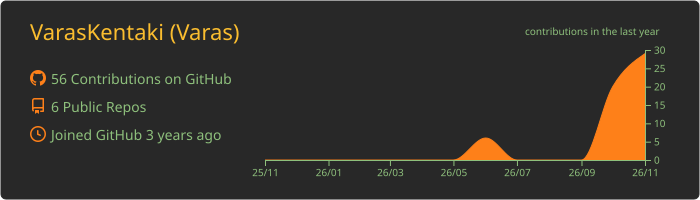
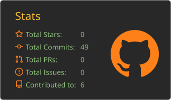
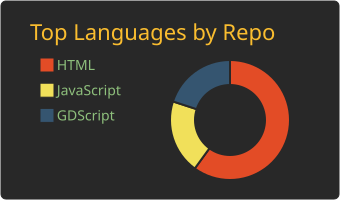
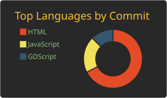
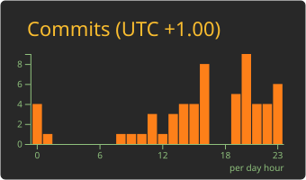

  

  

  
  
  

  
  
  

---

## ☕ Sobre mí

> 💬 _"Aprendo construyendo y experimentando."_

- 🎓 Cursando **2º de DAW**, aprendiendo las bases sólidas de la programación
- 🌱 Ahora mismo practico con **PHP**, **Java** y **Docker**
- 🎯 Objetivo: ser un **buen programador**, con criterio y buenas prácticas, y seguir creciendo sin cerrarme puertas
- 🌍 **Idiomas:** 🇪🇸 Español (nativo) · 🇬🇧 Inglés (básico-intermedio, leo documentación técnica a diario)

---

## 🧰 Tech Stack

  

  
  

---

## 🔨 Proyectos

Estos son algunos de mis proyectos y prácticas. Iré añadiendo más a medida que avance. 👀

<table align="center">
  <tr>
    <td align="center" valign="top">
      <h3>🃏 <a href="https://github.com/VarasKentaki/BlackJack">BlackJack</a></h3>
       
        
      
    </td>
    <td align="center" valign="top">
      <h3>🎓 <a href="https://github.com/VarasKentaki/Laberinto_Fantasmagorico">Laberinto Fantasmagórico</a></h3>
       
        
      
    </td>
    <td align="center" valign="top">
      <h3>👻 <a href="https://github.com/VarasKentaki/ComeCocos">ComeCocos</a></h3>
       
        
      
    </td>
  </tr>
</table>

---

## 🎯 Objetivos

- [ ] Mejorar mi **lógica y mi forma de resolver problemas** con proyectos completos
- [ ] Seguir aprendiendo **lenguajes y tecnologías nuevas** sin prisa y con base
- [ ] Desplegar aplicaciones con **Docker** y **Apache**
- [ ] Aplicar buenas prácticas con **Git, GitHub y GitLab**
- [ ] Mejorar mi **inglés técnico**
- [ ] Terminar **2º de DAW** y dar el salto al mundo laboral

---

## 📊 GitHub Stats

  

  
  

  
  

  

---

  

  ☕ <i>Siempre aprendiendo algo nuevo en programación</i>

